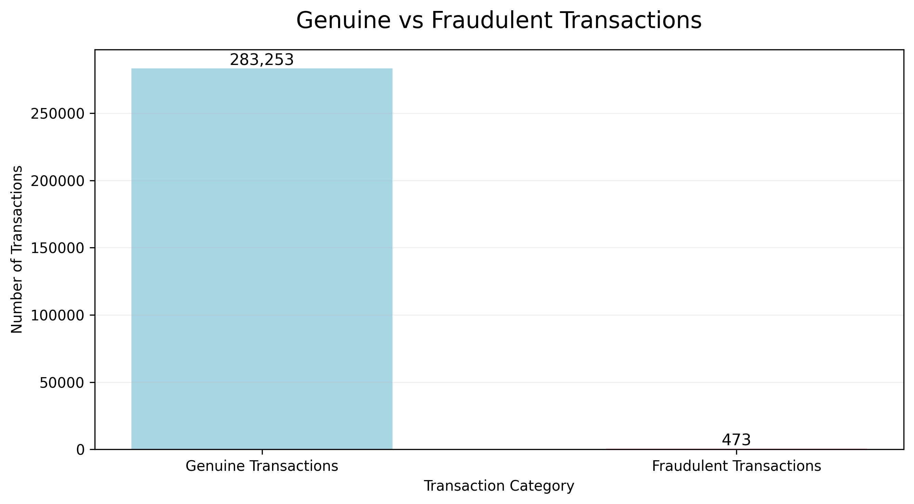
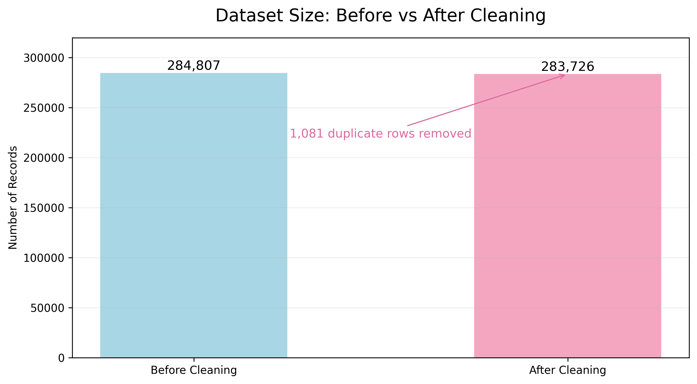
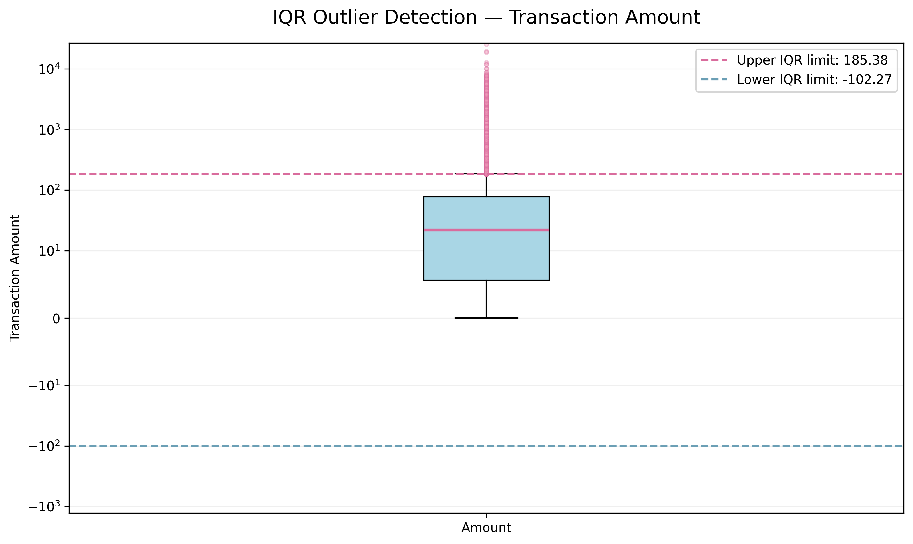
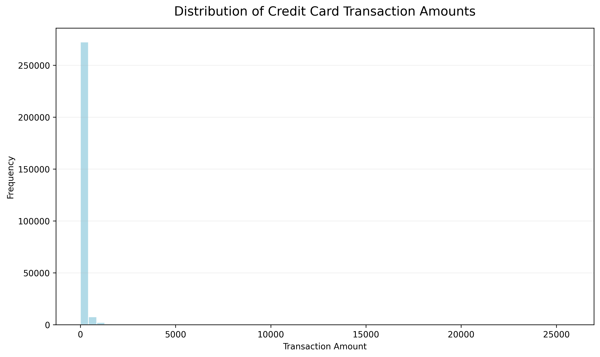

# Credit Card Fraud Dataset — Data Cleaning

**OIBSIP Internship | Task 1: Data Cleaning**

## Project Overview

This project focuses on cleaning and validating a real-world credit card transaction dataset. The objective is to identify data-quality issues, handle duplicate records, investigate missing values and detect potential outliers while preserving meaningful financial information.

The project was completed using Python in Google Colab.

## Tools & Technologies

- Python
- Pandas
- NumPy
- Matplotlib
- Seaborn
- Google Colab

## Dataset

**Source:** [Credit Card Fraud Detection Dataset — Zenodo](https://zenodo.org/records/7395559)

The dataset contains European credit card transactions from September 2013.

- Original records: 284,807
- Features: 30
- Target column: `Class`
- `0` represents genuine transactions.
- `1` represents fraudulent transactions.

## Data Cleaning Process

### 1. Initial Data Inspection
- Examined dataset dimensions.
- Checked column names and data types.
- Generated descriptive statistical summaries.

### 2. Missing Value Analysis
- Checked missing values in every column.
- Found zero missing values.
- No imputation was required.

### 3. Duplicate Removal
- Identified 1,081 exact duplicate rows.
- Removed duplicate records while retaining the first occurrence.
- Verified that no duplicates remained.

### 4. Data Validation
Checked for:
- Invalid transaction classes.
- Infinite numerical values.
- Negative transaction amounts.
- Negative transaction times.
- Remaining duplicate records.

No additional invalid values were identified in these checks.

### 5. Outlier Detection

**IQR Method**
- Q1: 5.60
- Q3: 77.51
- IQR: 71.91
- Upper boundary: 185.375
- Potential outliers detected: 31,685 (11.17%).

**Z-score Method**
- Threshold: ±3
- Potential outliers detected: 4,063 (1.43%).

**Treatment decision:** Potential outliers were investigated and retained. Extreme transaction amounts are not automatically data errors, and removing them could discard legitimate financial information.

### 6. Data Type Verification
Verified that:
- Transaction amount is numeric.
- Time is numeric.
- Class is integer.
- PCA-transformed features remain numeric.

No unnecessary type conversions were performed.

## Before vs After Cleaning

| Metric | Before | After |
|---|---:|---:|
| Total records | 284,807 | 283,726 |
| Duplicate rows | 1,081 | 0 |
| Missing values | 0 | 0 |
| Columns | 31 | 31 |

**Data retention: 99.62%**

### Final Class Distribution

| Transaction Type | Records |
|---|---:|
| Genuine | 283,253 |
| Fraudulent | 473 |

Note: 19 fraud-labelled rows were among the exact duplicate records removed.

## Visualizations

### 1. Genuine vs Fraudulent Transactions

### 2. Dataset Size Before and After Cleaning

### 3. IQR Outlier Detection

### 4. Transaction Amount Distribution

## Final Output

The cleaned dataset was exported as:

`creditcard_cleaned.csv`

- Final dimensions: 283,726 × 31
- Missing values: 0
- Duplicate rows: 0
- Export verification: Passed

## How to Run

1. Download or clone this repository.
2. Open the Google Colab notebook.
3. Download the original dataset from the source linked above.
4. Upload the dataset into the notebook runtime.
5. Execute the notebook cells in sequence.

## Conclusion

This project demonstrates a complete data-cleaning workflow, including data inspection, duplicate removal, validation, outlier investigation, data type verification and CSV export.

The cleaning process prioritizes data integrity by preserving legitimate extreme transaction values rather than blindly removing them.

---

**Internship:** Oasis Infobyte (OIBSIP)  
**Task:** Level 1 — Task 1: Data Cleaning
