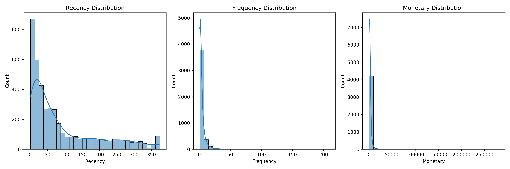
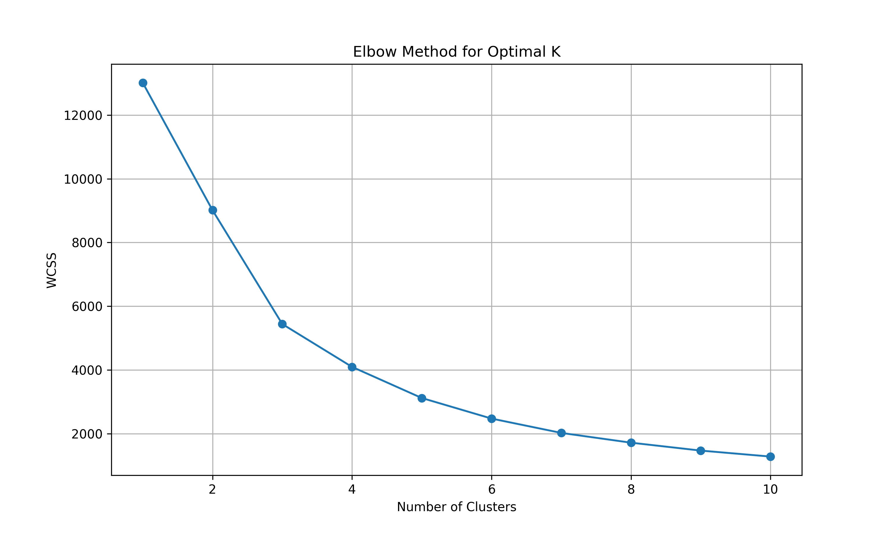
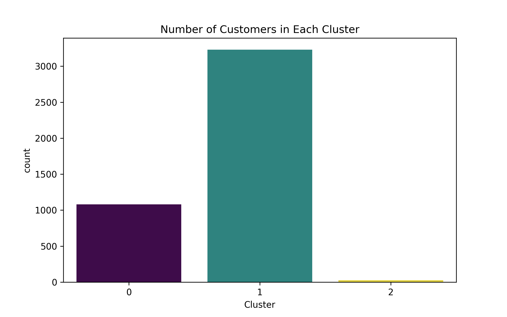
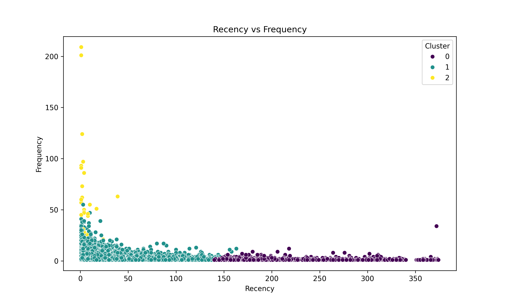
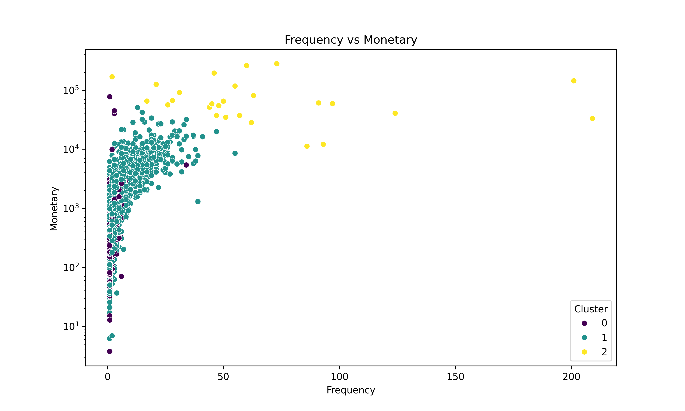

# Customer Segmentation Analysis

### OIBSIP Data Analytics Internship | Level 1 – Task 2


---

## 1. Project Overview

This project focuses on customer segmentation using machine learning techniques to identify distinct groups of customers based on their purchasing behaviour.

The analysis uses RFM (Recency, Frequency and Monetary) analysis combined with the K-Means clustering algorithm to group customers into meaningful segments.

The objective is to understand customer purchasing patterns and develop targeted marketing strategies for different customer groups.

## 2. Project Objectives

- Inspect and clean the retail transaction dataset.
- Handle missing values, duplicates and inconsistent records.
- Calculate Recency, Frequency and Monetary values.
- Apply feature scaling using StandardScaler.
- Determine the optimal number of clusters using the Elbow Method.
- Implement K-Means clustering.
- Visualize and interpret customer segments.
- Develop marketing recommendations for each customer group.

## 3. Dataset Information

**Dataset:** Online Retail Dataset

**Source:** [UCI Machine Learning Repository – Online Retail](https://archive.ics.uci.edu/dataset/352/online+retail)

The dataset contains transactions occurring between 01/12/2010 and 09/12/2011 for a UK-based online retail company.

### Original Dataset

| Attribute | Details |
|---|---|
| Original records | 541,909 |
| Original columns | 8 |
| Missing Description | 1,454 |
| Missing CustomerID | 135,080 |
| Duplicate records | 5,268 |
| Unique customers | 4,372 |
| Countries | 38 |

### Data Cleaning

The following cleaning operations were performed:

- Removed records with missing CustomerID.
- Removed duplicate records.
- Excluded cancelled invoices.
- Removed transactions with non-positive Quantity.
- Removed transactions with non-positive UnitPrice.
- Converted CustomerID into integer format.
- Created a new TotalPrice column.

The cleaned dataset contained **392,692 rows and 9 columns**.

## 4. Technologies Used

- Python
- Google Colab
- Pandas
- NumPy
- Matplotlib
- Seaborn
- Scikit-learn
- StandardScaler
- K-Means Clustering

## 5. Project Methodology

### Step 1: Data Inspection and Cleaning

The dataset was loaded and examined to understand its structure, data types, missing values and duplicate records.

Data cleaning was performed to improve data quality and ensure reliable customer segmentation.

### Step 2: RFM Analysis

RFM analysis was used to understand customer purchasing behaviour through three important metrics.

| Metric | Meaning |
|---|---|
| Recency | Number of days since the customer's last purchase |
| Frequency | Number of unique invoices purchased by the customer |
| Monetary | Total amount spent by the customer |

A snapshot date was calculated using the latest invoice date plus one day.

These three metrics were calculated for each customer using CustomerID.

### Step 3: Feature Scaling

StandardScaler was applied to Recency, Frequency and Monetary values.

Scaling ensures that features with larger numerical ranges do not disproportionately influence the K-Means clustering algorithm.

### Step 4: Elbow Method

The Elbow Method was used to determine the optimal number of clusters.

Different K values were tested, and their Within-Cluster Sum of Squares (WCSS) values were calculated.

The graph indicated an elbow around **K = 3**, so three clusters were selected.

### Step 5: K-Means Clustering

K-Means clustering was implemented with the following configuration:

- Number of clusters: 3
- Initialization: K-Means++
- Random state: 42
- Number of initializations: 10

Each customer was assigned to one of the three clusters.

### Step 6: Cluster Profiling

The clusters were analysed using their average Recency, Frequency and Monetary values.

The number of customers in each cluster was also examined to understand customer distribution.

## 6. Customer Segmentation Results

Three customer segments were identified.

| Cluster | Customers | Avg. Recency | Avg. Frequency | Avg. Monetary |
|---|---:|---:|---:|---:|
| Cluster 0 | 1,082 | 247.11 | 1.58 | £629.66 |
| Cluster 1 | 3,230 | 41.45 | 4.67 | £1,849.67 |
| Cluster 2 | 26 | 6.04 | 66.42 | £85,826.08 |

### Cluster 0 – At-Risk / Inactive Customers

- Highest average Recency.
- Lowest purchase Frequency.
- Lower average Monetary value.

**Marketing Recommendation:**
- Send personalized re-engagement campaigns.
- Offer limited-time discounts.
- Share product recommendations to encourage repeat purchases.

### Cluster 1 – Regular Customers

- Moderate average Recency.
- Regular purchase Frequency.
- Moderate average Monetary value.

**Marketing Recommendation:**
- Introduce loyalty and reward programs.
- Provide personalized product recommendations.
- Encourage repeat purchases through targeted promotions.

### Cluster 2 – High-Value VIP Customers

- Lowest average Recency.
- Highest purchase Frequency.
- Extremely high average Monetary value.

**Marketing Recommendation:**
- Provide exclusive offers and premium services.
- Introduce VIP loyalty benefits.
- Offer early access to new products.
- Maintain strong customer relationships through personalized engagement.

## 7. Data Visualizations

The following visualizations were generated during the analysis.

### 7.1 RFM Distributions

Shows the distribution of Recency, Frequency and Monetary values.



### 7.2 Elbow Method

Helps determine the optimal number of clusters for K-Means.



### 7.3 Customer Cluster Distribution

Shows the number of customers assigned to each cluster.



### 7.4 Recency vs Frequency

Visualizes customer segmentation based on Recency and Frequency.



### 7.5 Frequency vs Monetary

Shows the relationship between customer purchase frequency and monetary value.



## 8. Project Structure

```text
DataAnalytics-L1-CustomerSegmentation/
│
├── OIBSIP_Task2_Customer_Segmentation (2).ipynb
├── README.md
│
├── Customer_Cluster_Profile.csv
├── Customer_Segmentation_Results.csv
│
├── rfm_distributions.png
├── elbow_method.png
├── cluster_distribution.png
├── recency_frequency.png
└── frequency_monetary.png
```

## 9. Conclusion

This project demonstrates how customer segmentation can be performed using RFM analysis and K-Means clustering.

The analysis identified three distinct customer groups: At-Risk / Inactive Customers, Regular Customers and High-Value VIP Customers.

These segments provide useful insights into purchasing behaviour and can help businesses develop targeted marketing strategies, improve customer retention and increase customer lifetime value.

The project also demonstrates the importance of data cleaning, feature scaling, clustering and visualization in customer analytics.

## 10. Internship Information

**Organization:** Oasis Infobyte

**Program:** Data Analytics Internship

**Track:** Data Analytics

**Level:** Level 1

**Task:** Task 2 – Customer Segmentation Analysis

**Author:** [Aryan Fargose](https://github.com/Aryan-Fargose)

**GitHub Repository:** [OIBSIP](https://github.com/Aryan-Fargose/OIBSIP)
